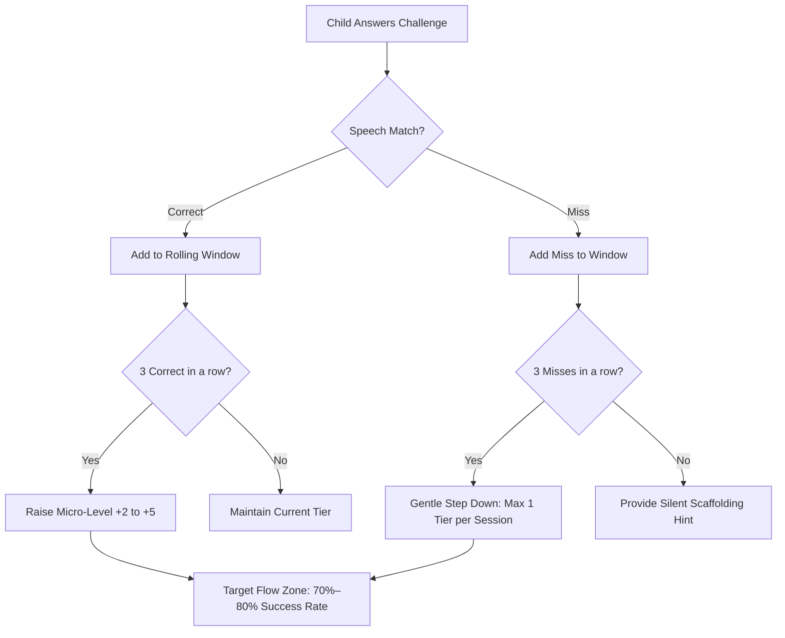

# 🦊 VOXIE QUEST — Speak, Play, Learn!

<p align="center">
  
</p>

<p align="center">
  <strong>Voice-Controlled Educational Web Gaming Tools for Enhanced Learning in the Skill Ecosystem</strong><br />
  <em>A hand-crafted, picture-book web game empowering children aged 5–10 to explore phonics, mathematics, science, emotional regulation, and storytelling using their natural voice.</em>
</p>

<p align="center">
  <a href="https://voxie-quest.vercel.app/"></a>
  <a href="#-quickstart-guide"></a>
  <a href="#-test-suite"></a>
  <a href="#-privacy-first--child-safe-guarantee"></a>
</p>

---

## 📑 Table of Contents

1. [🌟 Why Voxie Quest?](#-why-voxie-quest)
2. [🎮 The 8 Quest Realms](#-the-8-quest-realms)
3. [🎨 The Picture-Book Design System](#-the-picture-book-design-system)
4. [🧠 Intelligent Adaptive Difficulty Engine](#-intelligent-adaptive-difficulty-engine)
5. [🗣️ Childhood Phonological Speech Matcher](#️-childhood-phonological-speech-matcher)
6. [🏫 Classroom Adventure & Group Mode](#-classroom-adventure--group-mode)
7. [🌻 Safe Weekly Garden League & India Tour](#-safe-weekly-garden-league--india-tour)
8. [🏛️ Software Architecture & Component Tree](#️-software-architecture--component-tree)
9. [🚀 Quickstart Guide](#-quickstart-guide)
   - [Visual Studio 2022 (Ctrl+F5)](#option-a-visual-studio-2022-f5--ctrlf5)
   - [.NET 8 CLI](#option-b-net-8-cli)
10. [🧪 Test Suite (163 Automated Unit Tests)](#-test-suite)
11. [🌐 Production Deployment (Vercel & Netlify)](#-production-deployment-vercel--netlify)
12. [🛡️ Privacy-First & Child-Safe Guarantee](#️-privacy-first--child-safe-guarantee)

---

## 🌟 Why Voxie Quest?

Traditional educational software relies heavily on silent keyboard taps, repetitive mouse clicks, or high-friction logins. Young children learning to read and pronounce words often struggle with complex user interfaces or punitive "incorrect" alerts that induce anxiety.

**Voxie Quest** reimagines educational play from first principles:
- **Natural Voice-First Gameplay:** Children simply speak, roar, hum, or shout their answers. No typing required.
- **Zero Glossy Emojis — 100% Picture-Book SVGs:** Hand-crafted illustration aesthetics featuring warm cream paper backgrounds (`#FFF8E7`), bold 4px navy outlines (`#2B2D42`), and tactile hard offset shadows (`5px 5px 0px #2B2D42`).
- **Compassionate Pedagogy:** 3 progressive attempts per challenge. The word **"Wrong" is never displayed**. Instead, children receive encouraging nudges (*"Almost there! Listen closely!"*) and visual scaffolding.
- **Client-Side Privacy:** Zero tracking cookies, zero ads, zero passwords, and zero third-party telemetry. All speech evaluation and progression data reside securely in browser storage.

---

## 🎮 The 8 Quest Realms

Every game is built inside the unified `<GameShell>` architecture with responsive `100dvh` viewport management, dual-pane phone landscape support, and offline sound synthesis.

| Realm | Skill Category | Age Band | Learning Objective & Core Interaction | Interactive Artwork & Animation |
| :--- | :--- | :---: | :--- | :--- |
| **1. 🚀 Letter Rocket** | `SkillCategory.Letters` | 5–7 | Phonics, alphabet letter identification, and initial sounds. Say the displayed letter clearly. | Scaling SVG rocket on launchpad; exhaust clouds billow with fiery plume blast-off into starry space. |
| **2. 🐸 Number Jump** | `SkillCategory.Numbers` | 5–8 | Mental addition, counting, and numerical verbal fluency. Shout the sum to the math challenge. | Buoyant pond scene with animated green frog leaping across floating water lily pads into a sunny meadow. |
| **3. 🎨 Color Splash** | `SkillCategory.Colors` | 4–7 | Color recognition, shade identification, and speech clarity. Speak the name of the vibrant pigment. | Smiling paint bucket pours vibrant watercolor splashes onto black-and-white drawings, bringing them alive. |
| **4. 🦁 Animal Safari** | `SkillCategory.Animals` | 5–8 | Auditory discrimination and animal vocabulary. Listen to real calls; roar or speak the animal's name. | Shaking jungle grass reveals cartoon animals who hop onto Voxie's trailing expedition caravan wagon. |
| **5. 🧱 Word Builder** | `SkillCategory.Spelling` | 6–9 | CVC words, phonics blends, and spelling pronunciation. Speak the word formed by letter tiles. | Floating 3D toy blocks magnetically snap together with wooden clacks to unlock an illustrated gift surprise. |
| **6. 🔦 Team Light Quest** | `SkillCategory.Social` | 6–10 | Co-op collaboration, physics optics, and reflection angles. Speak *"Voxie, light the way!"* and rotate mirrors. | Hand-drawn sea scene with a wooden sailboat, rocky cliff, and striped lighthouse beaming golden light paths through fog. |
| **7. ⚖️ Island Balance** | `SkillCategory.Numbers` | 6–10 | Physical balance, lever torque, and mathematical equivalence. Add fruit weights to level the beam. | Tilting palm-log seesaw on a sandy beach fulcrum; pops up a cheerful wooden flag and confetti when balanced. |
| **8. 🌸 Mood Garden** | `SkillCategory.Storytelling`| 4–10 | Emotional self-regulation, somatic breath pacing, and calm. Hum *"Hooommm"* or breathe with the ring. | Storm clouds dissolve into a smiling morning sun; shivering baby fox wakes up, stretches, and blooms a lotus. |

---

## 🎨 The Picture-Book Design System

Voxie Quest adheres to a strict, accessible design token system defined in [`wwwroot/css/app.css`](file:///C:/Users/Nilesh%20gupta/.gemini/antigravity/scratch/VoxieQuest/src/VoxieQuest.Web/wwwroot/css/app.css) and showcased interactively at `/styleguide`:

```
┌────────────────────────────────────────────────────────────────────────┐
│                   PICTURE-BOOK COLOR PALETTE                           │
├─────────────┬─────────────┬─────────────┬─────────────┬────────────────┤
│ Sunny Yellow│  Sky Blue   │    Coral    │ Mint Green  │  Soft Orange   │
│   #FFC93C   │   #5BC0EB   │   #FF6B6B   │   #7ED9A8   │    #FF9F43     │
├─────────────┴─────────────┴─────────────┴─────────────┴────────────────┤
│   Cream Paper Background: #FFF8E7   │   Navy Ink Borders: #2B2D42      │
└────────────────────────────────────────────────────────────────────────┘
```

### Key UI Principles:
- **Strict 4px Navy Outlines:** Every card, button, token, and illustration is bounded by `4px solid #2B2D42`.
- **Hard Offset Shadows:** Flat, tactile offset shadows (`5px 5px 0 #2B2D42` and `8px 8px 0 #2B2D42`) that physically depress to `1px 1px 0` on tap.
- **Zero Glossy Emojis:** Replaced 100% of platform emojis with bespoke, accessible SVG components (`<FoxieFaceIcon>`, `<StarIcon>`, `<SunIcon>`, `<LotusIcon>`, `<ScaleIcon>`, `<BeaconIcon>`, `<BackpackIcon>`, etc.).
- **Tactile Bouncy Buttons:** Minimum **72px touch targets** (`min-height: 72px`) for children's developing motor skills, complete with Web Audio bubble-pop sound feedback.
- **Accessibility Modes:** Native support for **Dyslexia Font** (increased tracking and bottom-heavy baselines), **Colorblind Textures** (stripes, dots, and diagonal hatch fills), and **Reduced Motion**.

---

## 🧠 Intelligent Adaptive Difficulty Engine

The difficulty model (`IDifficultyService` & `IAdaptiveDifficultyService`) continuously analyzes player flow without making the child feel tested or discouraged:



- **Hidden Micro-Level (1–100):** Adjusts numerical bounds, word complexity, letter pools, and timer thresholds smoothly under the hood.
- **Child-Friendly Tier Labels:** Children only see encouraging botanical stages:
  - 🌱 **Seedling** (Foundational)
  - 🌿 **Sapling** (Intermediate)
  - 🌳 **Big Tree** (Mastery)
- **Zero Code-Tuning:** All tier parameters are externalized in JSON files located in `wwwroot/data/difficulty/*.json`.

---

## 🗣️ Childhood Phonological Speech Matcher

Young children frequently exhibit normal developmental speech variations (e.g. saying *"wabbit"* for *"rabbit"* or *"fip"* for *"ship"*). Standard speech engines fail them.

Voxie Quest's C# engine (`SpeechMatcher.cs`) applies **developmental phonological transforms**:
1. **Liquid Gliding:** Normalizes `/r/` and `/l/` $\to$ `/w/` and `/j/` (*"wed"* $\to$ *"red"*).
2. **Velar Fronting:** Handles `/k/` and `/g/` $\to$ `/t/` and `/d/` (*"tootie"* $\to$ *"cookie"*).
3. **Stopping of Fricatives:** Compares `/s/`, `/sh/`, `/th/` variations (*"sun"* $\to$ *"tun"*).
4. **Phonetic Distance:** Combines Soundex, Metaphone, and normalized Levenshtein distance metrics to reward effort over adult-like articulation.

---

## 🏫 Classroom Adventure & Group Mode

Accessible via `/classroom` for teachers and homeschooling pods:

<p align="center">
  
</p>

- **64px Touch-Friendly Join Box:** Children type the 6-character room code from the blackboard into a large, centered input (`OAK-742`) with an aligned `BouncyButton`.
- **Ephemeral In-Memory Pods:** All student state exists in-memory during class time and auto-destructs after 60 minutes.
- **Zero Student Accounts:** No emails, no student rosters stored, and no tracking.
- **Class Circle Discussion Cards:** Built-in reflection cards for teachers to guide post-game group debriefs.

---

## 🌻 Safe Weekly Garden League & India Tour

### Weekly Garden League (`/league`)
- **Safety Rule:** Children are **never ranked against strangers**. Leagues exist exclusively within private family rooms or pre-approved teacher codes.
- **Safe Display Names:** Auto-generated child-friendly names from curated word lists (*"Brave Panda"*, *"Sunny Otter"*).
- **Effort-Based Scoring:** Points are awarded for completing rounds, practicing daily streaks, and trying hints.
- **Daily 150-Point Rest Cap:** Prevents addictive screen pressure by encouraging healthy rest once the cap is achieved.
- **Under 13 Protection:** Children see only the top 5 friends, star growth, and team flower baskets—never last place.

### Voxie Across India (`/india-map`)
- Interactive exploration map featuring all Indian states and union territories.
- Each state unlocks a cultural fun fact and landmark sticker (e.g. Punjab: Golden Temple, Rajasthan: Camel Caravan, Kerala: Backwater Boat).
- 100% static exploration mode with optional parent-gated anonymous presence aggregation (DPDP Act 2023 compliant).

---

## 🏛️ Software Architecture & Component Tree

```
VoxieQuest.sln
│
├── 📁 src/VoxieQuest.Web/               # Blazor WebAssembly Standalone (.NET 8)
│   ├── 📁 Components/                  # Reusable Picture-Book UI Layer
│   │   ├── 📁 Icons/                   # Flat inline SVGs (Sun, Star, Mic, Backpack...)
│   │   ├── BouncyButton.razor          # Squishy 72px tactile action button
│   │   ├── GameShell.razor             # Unified 100dvh layout stage
│   │   ├── GameHeader.razor            # Compact 10-seed sprouting stepper & back nav
│   │   ├── QuestionCard.razor          # Paper-cut card with speech bubble & Mascot
│   │   ├── MicButton.razor             # 96px mic sphere with live audio volume rings
│   │   ├── AnswerChips.razor           # 2x2 touch practice buttons
│   │   ├── FeedbackBurst.razor         # Gentle confetti or wobble encouragement
│   │   ├── LevelMap.razor              # 4-zone winding trail of stepping stones
│   │   ├── EmptyState.razor            # Friendly no-data state
│   │   └── ErrorBoundaryScreen.razor   # Child-safe recovery screen
│   │
│   ├── 📁 Pages/                       # Routing Views
│   │   ├── Home.razor                  # Waving Voxie, daily goal, quick-play cards
│   │   ├── GameSelect.razor            # 8 chunky quest cards in 2-column grid
│   │   ├── ClassroomMode.razor         # Student room joiner & teacher station
│   │   ├── SkillGarden.razor           # 6 botanical skill plots & watering can
│   │   ├── StickerBook.razor           # Spiral album with corner-peel stickers
│   │   ├── LeaguePage.razor            # Weekly team garden league
│   │   ├── Profile.razor               # 6 animal avatar pickers & name generator
│   │   ├── ParentDashboard.razor       # Math-gated parental controls & DPDP notice
│   │   ├── StyleGuide.razor            # Interactive design system token catalog
│   │   └── 📁 Games/                   # The 8 individual game realms
│   │
│   ├── 📁 Services/                    # Pure C# Business Logic & Injected Services
│   │   ├── SpeechMatcher.cs            # Childhood phonological fuzzy matcher
│   │   ├── VoiceManager.cs             # Speech recognition & synthesis bridge
│   │   ├── DifficultyService.cs        # Adaptive micro-level (1-100) engine
│   │   ├── ProgressService.cs          # Local profile & mastery persistence
│   │   ├── ClassroomService.cs         # Ephemeral room code coordination
│   │   ├── StreakService.cs            # Daily streak & flame tracking
│   │   └── WeeklyLeagueService.cs      # Team garden scoring & daily caps
│   │
│   └── 📁 wwwroot/                     # Static Web Assets
│       ├── 📁 css/                     # app.css (tokens, typography, animations)
│       ├── 📁 fonts/                   # Offline local Fredoka & Nunito fonts
│       └── 📁 js/                      # voxieInterop.js (Speech, Web Audio API)
│
└── 📁 tests/VoxieQuest.Tests/          # Automated xUnit Test Suite (163 tests)
```

---

## 🚀 Quickstart Guide

### Option A: Visual Studio 2022 (F5 / Ctrl+F5)

1. **Prerequisites:** Visual Studio 2022 (v17.8+) with the **ASP.NET and web development** workload.
2. Open `VoxieQuest.sln`.
3. In **Solution Explorer**, right-click `src/VoxieQuest.Web` and select **Set as Startup Project**.
4. Press **`Ctrl + F5`** (Start Without Debugging).
5. Visual Studio will restore packages, compile the Blazor WASM binary, launch the local server, and open your browser at `https://localhost:port`.
6. When prompted, click **Allow** on the microphone permission dialog.

### Option B: .NET 8 CLI

```bash
# 1. Clone the repository
git clone https://github.com/nileshkrishesh/VoxieQuest.git
cd VoxieQuest

# 2. Restore and Build
dotnet build src/VoxieQuest.Web/VoxieQuest.Web.csproj

# 3. Run the Web App
dotnet run --project src/VoxieQuest.Web/VoxieQuest.Web.csproj
```

Open your browser and navigate to `http://localhost:5000` or `https://localhost:5001`.

---

## 🧪 Test Suite

The solution contains a comprehensive suite of **163 automated unit tests** covering speech recognition, difficulty curves, childhood phonology transforms, scoring algorithms, and security boundaries:

```bash
dotnet test tests/VoxieQuest.Tests/VoxieQuest.Tests.csproj
```

### Verified Test Output:
```text
Passed!  - Failed: 0, Passed: 163, Skipped: 0, Total: 163, Duration: 510 ms - VoxieQuest.Tests.dll (net8.0)
```

---

## 🌐 Production Deployment (Vercel & Netlify)

Because Voxie Quest is a standalone client-side WebAssembly application, it deploys cleanly to any static CDN host:

### Publish Release Artifacts:
```bash
dotnet publish src/VoxieQuest.Web/VoxieQuest.Web.csproj -c Release -o publish
```

### Vercel Deployment Configuration (`vercel.json`):
```json
{
  "outputDirectory": "publish/wwwroot",
  "cleanUrls": true,
  "rewrites": [
    { "source": "/(.*)", "destination": "/index.html" }
  ]
}
```

---

## 🛡️ Privacy-First & Child-Safe Guarantee

Voxie Quest was engineered in strict compliance with the **Children's Online Privacy Protection Act (COPPA)** and India's **Digital Personal Data Protection Act (DPDP Act 2023)**:

- 🚫 **Zero Third-Party Ads or Popups**
- 🚫 **Zero Tracking Pixels or Remote Telemetry**
- 🚫 **Zero Social Media Plugins**
- 🚫 **Zero Account Registration or Passwords Required**
- 🔒 **100% Local Storage:** Child names, avatars, stars, and speech records never leave the local device.
- 🛡️ **Math-Gated Parent Dashboard:** Settings, screen-time rest limits, and data deletion controls are secured behind an adult verification gate.

---

<p align="center">
  <strong>VOXIE QUEST</strong> • <em>Speak, Play, Learn!</em><br />
  Designed with ❤️ for curious young minds everywhere.
</p>
